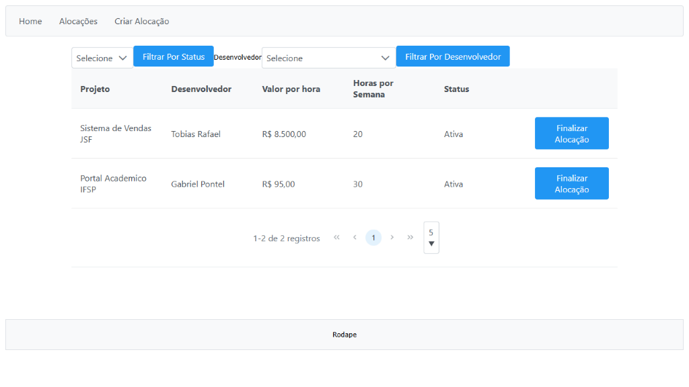

# Sistema de Alocação de Desenvolvedores em Projetos


Aplicação web desenvolvida em Java com Jakarta EE (JSF, EJB, CDI e JPA) e PrimeFaces para a avaliação prática da disciplina de Ferramentas de Programação no IFSP (Campus Presidente Epitácio). O sistema gerencia a alocação de desenvolvedores em projetos, controlando carga horária semanal, valor da hora, status e regras de disponibilidade.

---

## Capturas de tela

### Cadastro de nova alocação (`alocacao/criar.xhtml`)
Formulário para selecionar projeto e desenvolvedor, informando horas semanais e valor por hora.


### Listagem e filtros (`alocacao/lista.xhtml`)
Tabela paginada com filtros por status (ativas ou finalizadas) e por desenvolvedor, além de botão para finalizar alocações ativas.



---

## Funcionalidades

- Cadastro de alocação vinculando desenvolvedor a um projeto com horas semanais e valor da hora.
- Validação de disponibilidade: impede alocar um desenvolvedor que já possui uma alocação ativa.
- Listagem em tabela paginada com formatação monetária.
- Filtros por status (ativas ou finalizadas) e por desenvolvedor.
- Finalização de alocações ativas diretamente pela listagem.

---

## Tecnologias utilizadas

- Frontend: Jakarta Faces (JSF / Facelets) e PrimeFaces 15.0.6
- Backend e regras: CDI (@Named, @RequestScoped) e EJB (@Stateless)
- Banco de dados e persistência: JPA com EclipseLink e MySQL
- Entidades: Desenvolvedor, Projeto, Alocacao (chave composta com AlocacaoPK) e StatusAlocacao

---

## Estrutura do projeto

```text
Prova-ferramentas/
├── src/
│   ├── conf/
│   │   └── persistence.xml              # Unidade de persistência (conexaoPU)
│   └── java/br/edu/ifsp/pep/
│       ├── controller/
│       │   └── AlocacaoController.java  # Controle de criação, filtros e finalização
│       ├── converter/
│       │   ├── DesenvolvedorConverter.java
│       │   └── ProjetoConverter.java
│       ├── dao/
│       │   ├── AlocacaoDAO.java         # Regras de negócio e consultas JPA
│       │   ├── DesenvolvedorDAO.java
│       │   └── ProjetoDAO.java
│       └── entidade/
│           ├── Alocacao.java
│           ├── AlocacaoPK.java
│           ├── Desenvolvedor.java
│           ├── Projeto.java
│           └── StatusAlocacao.java
├── web/
│   ├── index.xhtml                      # Página inicial
│   ├── alocacao/
│   │   ├── criar.xhtml                  # Formulário de nova alocação
│   │   └── lista.xhtml                  # Listagem, filtros e finalização
│   ├── resources/css/                   # Folhas de estilo do template
│   └── WEB-INF/
│       ├── template.xhtml               # Template principal com menu e p:growl
│       └── glassfish-resources.xml      # Pool JDBC MySQL (dev_proj)
└── images/                              # Capturas de tela do sistema
```

---

## Como executar

### Pré-requisitos
- Java JDK 17
- GlassFish 7 (com o driver JDBC do MySQL configurado)
- MySQL Server rodando na porta 3306
- NetBeans (ou IDE de preferência com suporte a Ant/Jakarta EE)

### Passos
1. Clone o repositório:
   ```bash
   git clone https://github.com/rtobias-git/Prova-ferramentas.git
   ```
2. Verifique as configurações de conexão com o banco em `web/WEB-INF/glassfish-resources.xml`.
3. Abra o projeto no NetBeans, adicione as dependências da biblioteca Java Web / PrimeFaces e faça o deploy no GlassFish.
4. Cadastre desenvolvedores e projetos no banco para começar a realizar as alocações.

---

## Autor

Desenvolvido por **Tobias Rafael** ([@rtobias-git](https://github.com/rtobias-git)), estudante do IFSP Campus Presidente Epitácio.
