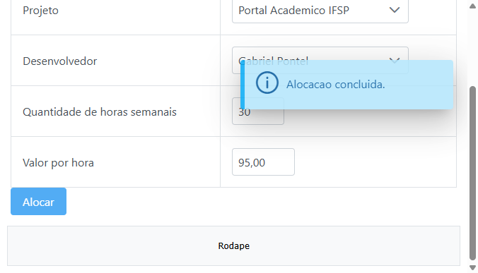

# 📋 Sistema de Alocação de Desenvolvedores em Projetos


Aplicação web desenvolvida em **Java com Jakarta EE (JSF/Facelets, EJB, CDI e JPA)** e **PrimeFaces** como avaliação prática da disciplina de **Ferramentas de Programação** (IFSP — Campus Presidente Epitácio). O sistema gerencia a alocação de desenvolvedores em projetos, controlando carga horária semanal, valor por hora, status e regras de disponibilidade.

---

## 📸 Capturas de Tela

### Cadastro de Nova Alocação (`alocacao/criar.xhtml`)
Seleção de projeto e desenvolvedor, definição de horas semanais e valor por hora, com feedback imediato via componente de notificação (`p:growl`).



### Listagem, Filtros e Finalização (`alocacao/lista.xhtml`)
Tabela paginada com filtros por **Status** (`Ativas` / `Finalizadas`) e por **Desenvolvedor**, além da ação para finalizar alocações em andamento.


---

## ⚙️ Funcionalidades

- **Cadastro de Alocação:** Associa um `Desenvolvedor` a um `Projeto`, informando a quantidade de horas semanais e o valor da hora trabalhada.
- **Regra de Negócio (Disponibilidade):** Antes de persistir uma nova alocação, o `AlocacaoDAO` verifica se o desenvolvedor já possui alguma alocação com status `Ativa`, impedindo alocações simultâneas em múltiplos projetos.
- **Listagem e Paginação:** Exibição de todas as alocações em `p:dataTable` paginada (5 ou 10 registros por página, ou exibição completa) com formatação monetária.
- **Filtros Dinâmicos:** Pesquisa de alocações por **Status** (`Ativa` ou `Finalizada`) ou por **Desenvolvedor**.
- **Finalização de Alocação:** Altera o status de uma alocação ativa para `Finalizada` no banco de dados via JPA, liberando o desenvolvedor para novos projetos.

---

## 🛠️ Tecnologias e Arquitetura

- **Frontend:** Jakarta Faces (JSF / Facelets), PrimeFaces `15.0.6` e CSS (`default.css`, `cssLayout.css`).
- **Camada de Controle:** CDI Managed Bean (`AlocacaoController` com `@Named` e `@RequestScoped`) e `FacesConverter` customizados (`DesenvolvedorConverter`, `ProjetoConverter`).
- **Camada de Persistência:** EJB (`@Stateless`) + Jakarta Persistence (JPA 3.0) com EclipseLink e MySQL (`java:app/dev_proj`).
- **Entidades:**
  - `Desenvolvedor` (`id`, `nome`)
  - `Projeto` (`id`, `nome`)
  - `Alocacao` (chave composta `AlocacaoPK` com `desenvolvedor_id` e `projeto_id`, `valor_da_hora`, `quantidade_de_horas`, `status`)
  - `StatusAlocacao` (`Ativa`, `Finalizada`)

---

## 📁 Estrutura do Projeto

```text
Prova-ferramentas/
├── src/
│   ├── conf/
│   │   └── persistence.xml              # Unidade de persistência (conexaoPU)
│   └── java/br/edu/ifsp/pep/
│       ├── controller/
│       │   └── AlocacaoController.java  # Controle de criação, filtros e finalização
│       ├── converter/
│       │   ├── DesenvolvedorConverter.java
│       │   └── ProjetoConverter.java
│       ├── dao/
│       │   ├── AlocacaoDAO.java         # Regras de negócio e consultas JPA
│       │   ├── DesenvolvedorDAO.java
│       │   └── ProjetoDAO.java
│       └── entidade/
│           ├── Alocacao.java
│           ├── AlocacaoPK.java
│           ├── Desenvolvedor.java
│           ├── Projeto.java
│           └── StatusAlocacao.java
├── web/
│   ├── index.xhtml                      # Página inicial
│   ├── alocacao/
│   │   ├── criar.xhtml                  # Formulário de nova alocação
│   │   └── lista.xhtml                  # Listagem, filtros e finalização
│   ├── resources/css/                   # Folhas de estilo do template
│   └── WEB-INF/
│       ├── template.xhtml               # Template principal com menu e p:growl
│       └── glassfish-resources.xml      # Pool JDBC MySQL (dev_proj)
└── images/                              # Capturas de tela do sistema
```

---

## 🚀 Como Executar Localmente

### Pré-requisitos
- **Java JDK 17** (ou compatível com Jakarta EE 10)
- **GlassFish 7** (configurado com o driver JDBC do MySQL em `domains/domain1/lib`)
- **MySQL Server** em execução na porta `3306`
- **Apache NetBeans** (recomendado para abrir e compilar o projeto Ant)

### Passos
1. Clone este repositório:
   ```bash
   git clone https://github.com/rtobias-git/Prova-ferramentas.git
   ```
2. Verifique as credenciais do banco em `web/WEB-INF/glassfish-resources.xml` (por padrão aponta para `localhost:3306/dev_proj`).
3. Abra o projeto no NetBeans, certifique-se de que as bibliotecas (`primefaces-15.0.6-jakarta.jar` e `java-web-library.jar`) estão vinculadas e faça o **Deploy** no GlassFish.
4. Cadastre registros iniciais nas tabelas `desenvolvedor` e `projeto` e acesse:
   ```text
   http://localhost:8080/projeto-inicial/
   ```

---

## 👤 Autor

Desenvolvido por **Tobias Rafael** ([@rtobias-git](https://github.com/rtobias-git)) — IFSP Campus Presidente Epitácio.
